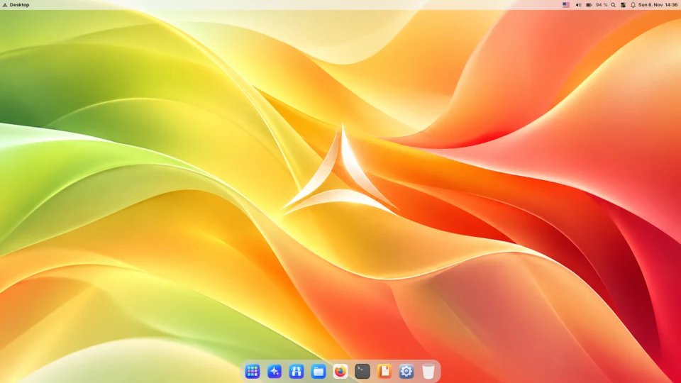
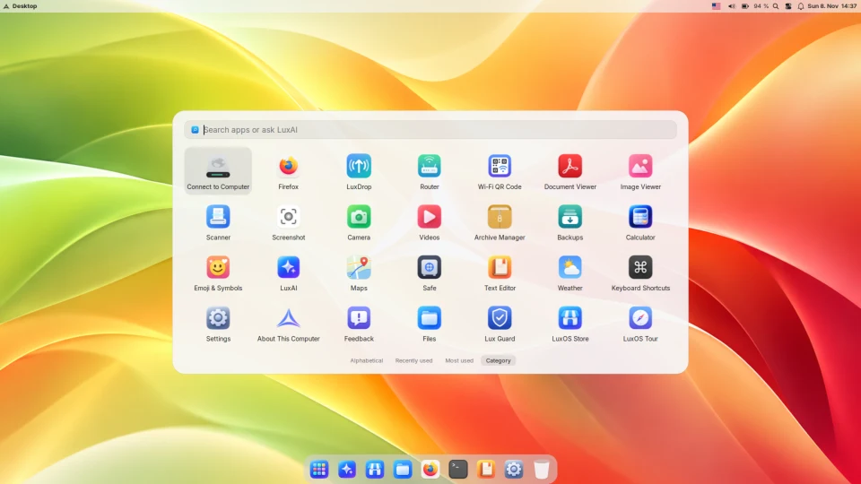
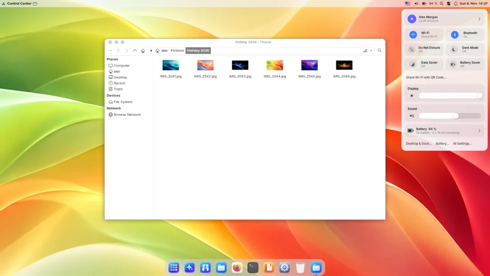
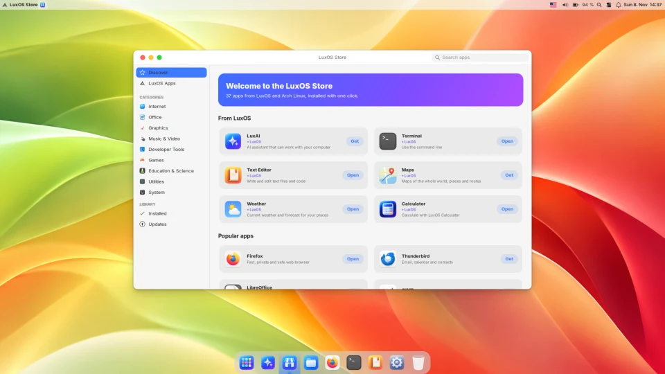
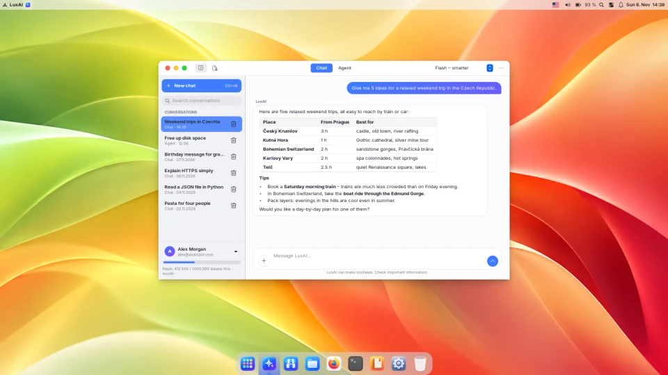

<p align="center">
  
</p>

<h1 align="center">LuxOS</h1>

<p align="center">
  A fast, lightweight Linux distribution based on Arch Linux, with a macOS-like desktop.<br>
  <a href="https://luxos.lux-ai.cz/"><b>Website</b></a> ·
  <a href="https://luxos.lux-ai.cz/#download"><b>Download</b></a> ·
  <a href="https://luxos.lux-ai.cz/docs/">Documentation</a> ·
  <a href="https://luxos.lux-ai.cz/changes/">Changelog</a> ·
  <a href="https://luxos.lux-ai.cz/cs/">Česky</a>
</p>

<p align="center">
  <a href="https://luxos.lux-ai.cz/changes/"></a>
  
  
  
  <a href="LICENSE"></a>
</p>



> **Beta.** LuxOS is a young project (public since October 2026). Expect bugs and back up your data
> before installing.

## What is LuxOS?

LuxOS is Arch Linux set up as a polished, macOS-style desktop that maintains itself. Under the hood
it is Xfce (the xfwm4 compositor and panel), not a heavy shell; on top are a top bar, the Plank dock,
Launchpad, Search and a Control Center. It is a rolling release: installed systems update with
`lux update`, usually automatically in the background.

## Features

- **macOS-like desktop** – top bar with the active app and Control Center, Dock, Launchpad
  (`Super+A`), Search (`Super+Space`), Cmd-style shortcuts, light/dark/automatic appearance. Own
  icons, no Apple logos or icons.
- **`lux` package manager** – no `pacman` command; `lux` uses libalpm with its own TOML configuration
  (`/etc/lux/lux.conf`) and installs from the Arch and signed LuxOS repositories, Flathub, the AUR
  (checked and built in a sandbox) and LuxOS's own `.lux` app format. Graphical **LuxOS Store** on top.
- **Own kernel build** – `linux-luxos`: vanilla stable kernel.org Linux with Arch's configuration plus
  LuxOS settings, no out-of-tree patches, built and QEMU-tested automatically
  ([luxopes/luxos-kernel](https://github.com/luxopes/luxos-kernel)); `scx_lavd` scheduler on desktops.
- **LuxOS Care** – background updates, a read-only Btrfs snapshot before every update with
  `luxos-care rollback`, previous kernel kept in the boot menu, read-only `/usr` and a weekly
  integrity check, self-repair.
- **Security** – firewall on by default (nftables, Allow/Keep Blocked prompts), **Lux Guard** checks
  programs from downloads/USB when they start and offers the sandbox, hourly `/home` snapshots,
  **Safe** (encrypted folder), **Sandbox** for untrusted apps, signed packages.
- **Hassle-free drivers** – Intel, AMD and NVIDIA (including legacy branches and hybrid laptops), Intel
  SOF audio, IPU6 cameras, Broadcom Wi‑Fi, fingerprint readers, VM guest tools; detected at install
  and afterwards (Drivers app, `lux drivers`).
- **LuxOS apps** – Store, Software Update, Control Center, Weather, Maps, Calculator, Terminal, Text
  Editor, LuxDrop (LocalSend-compatible file sharing), Backups, Printers & Scanners and more.
- **LuxAI** (optional) – an assistant with Chat and Agent modes that asks before risky actions;
  needs a LuxAI account with monthly limits. Answers are processed by third-party model providers
  ([privacy policy](https://luxos.lux-ai.cz/privacy/)).
- **LSL** – several system tools are written in [LSL](https://lsl.lux-ai.cz), a small compiled
  language by the same author; the `lsh` shell (a GNU bash fork) runs LSL statements directly.
- **13 languages**, including English, Czech, Slovak, German and Polish.

## Screenshots

| | |
|---|---|
|  |  |
|  |  |

More in the [gallery](https://luxos.lux-ai.cz/#gallery).

## Install

1. Download the ISO from <https://luxos.lux-ai.cz/#download> and verify it
   (`sha256sum -c SHA256SUMS`, then `gpg --verify` with the LuxOS key – instructions on the page).
2. Write it to a USB drive (4 GB+) with Fedora Media Writer, balenaEtcher or `dd`.
3. Boot it, try LuxOS live, then start **Install LuxOS**. The installer offers the whole disk, free
   space next to Windows, an existing partition or manual partitioning with LVM and LUKS2 encryption.

Requirements: 64-bit PC (x86_64), UEFI or BIOS, at least 20 GB disk, internet connection during
installation (about 10 minutes). Details: [Installing LuxOS](https://luxos.lux-ai.cz/docs/luxos/installer.html),
[Hardware support](https://luxos.lux-ai.cz/docs/luxos/hardware.html).

## Build from source

You only need `podman` (or `docker`); everything else runs in an Arch Linux container.

```bash
./build.sh            # LuxOS packages + ISO -> out/luxos-*.iso
./build.sh packages   # packages only (out/repo)
./build.sh iso        # ISO from built packages
scripts/test-vm.sh live   # boot the ISO in QEMU/KVM (UEFI)
```

The full developer guide (repositories, signing, `lux` internals, project layout) is in Czech:
[docs/README.cs.md](docs/README.cs.md).

## Contributing and support

- Bugs and ideas: [GitHub issues](https://github.com/luxopes/LuxOS-Arch/issues), or the Feedback app
  in LuxOS.
- Contact: Antonín Tomeček – <info@lux-ai.cz>
- Anonymous usage counts (opt-out): <https://luxos.lux-ai.cz/usage/>

## License

LuxOS's own code (the `luxos-*` packages, `lux`, `luxdrop`, scripts and the installer) is licensed
**GPL-3.0-or-later** – see [LICENSE](LICENSE). Third-party packages and patches (kernel, NVIDIA
drivers, WhiteSur themes, ble.sh, LSL, …) keep their own licenses, listed in their `PKGBUILD`s.
